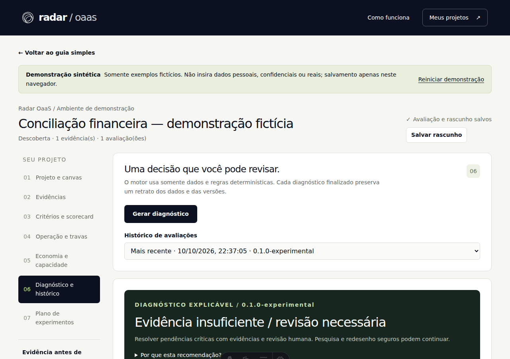

# Demonstração e estudo de caso

[README](../../README.md) · [English overview](../../README_EN.md)

## Problema

Organizar evidências e definir qual experimento uma oportunidade pode realizar.

## Decisão de engenharia e contribuição do projeto

Separar regras determinísticas, dados ausentes e revisão humana; a demonstração funciona com dados sintéticos no navegador.

A implementação e a avaliação estão no repositório; bibliotecas e motores de terceiros conservam autoria e condições próprias. Este estudo descreve o estágio observado, sem atribuir validação comercial a uma demonstração.

## Entrada → operação → resultado

Siga a sequência de [RECORDING.md](RECORDING.md). A imagem abaixo e o vídeo mostram a interface real, executada localmente com dados fictícios.

[▶ Assistir ao vídeo de aproximadamente 44 segundos](demo.mp4)

Vídeo sem narração; interface em português. Esta é uma demonstração selecionada, não uma homologação E2E completa.

## Resultado verificado

132 testes unitários/IA aprovados em seis arquivos; exemplo de conciliação gerou diagnóstico com evidência insuficiente e revisão necessária.

- Comando: `npm run test:unit`.
- Código executado: [`f536e39cd69b`](https://github.com/ofelipepeixoto/radar-oaas/tree/f536e39cd69b0c5272f5567fc89c910590ea2096).
- Ambiente: Linux, Python 3.12.14 para PDF; Node 24.19.0 para aplicações web.
- Reprodução: 11/10/2026 UTC, 10/10/2026 em São Paulo.

## Limites e aprendizado

A rodada não validou Auth/RLS real, IA paga, produção ou retorno econômico. O diagnóstico não é certificação nem autorização automática.

A diferença entre dados pendentes, evidência sintética e resultado validado continua visível. Não foram medidos produtividade, adoção, receita ou satisfação de clientes nesta rodada. Contagens de testes não substituem essas métricas.

## Reproduzir

Use os comandos do [README](../../README.md), apenas fixtures fictícias e a sequência de [RECORDING.md](RECORDING.md). O [guia em inglês](../../README_EN.md) explica entrada, operação, resultado e limites para visitantes internacionais. Não grave dados privados, credenciais ou documentos de clientes.
